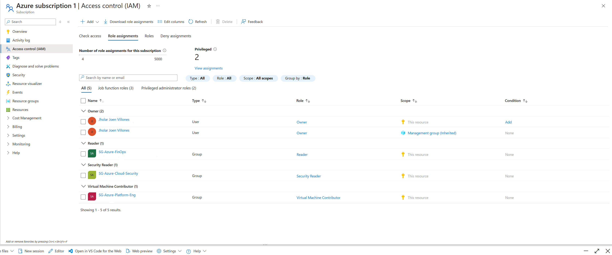

# Project 02: Automated Entra ID Lifecycle & RBAC Governance Engine

## Business Problem
Manual user onboarding and direct user-level RBAC role assignments lead to privilege creep, inconsistent access controls, and compliance audit gaps across enterprise cloud environments.

## Solution
An idempotent **Azure CLI (Bash)** identity governance engine that ingests HR onboarding CSV feeds, dynamically provisions department-based Entra ID Security Groups, enforces least-privilege RBAC roles at the subscription scope, and handles Entra ID-to-ARM replication latency.

## Security & Governance Highlights
- **Zero Direct User Assignments:** Enforces group-based RBAC (`Security Reader`, `Virtual Machine Contributor`, `Reader`) aligned with least-privilege principles.
- **Idempotent Execution:** Safely checks for existing security groups before creation to prevent duplicate resources or script failures on re-runs.
- **Replication Delay Mitigation:** Implements propagation buffers (`sleep 15`) between Microsoft Entra ID group creation and Azure Resource Manager (ARM) role assignment to prevent `PrincipalNotFound` race conditions.
- **Auditability:** Captures timestamped compliance execution logs inside `/logs` for SOC2/ISO-27001 audit readiness.

## How to Run
```bash
chmod +x provision_identity_rbac.sh
./provision_identity_rbac.sh
```

## Proof of Execution (Azure Portal IAM)

